<div align="center">
  
  <h1>DeepLinks</h1>
  <p><b>DeepSeek Harness 的手机端</b> · 任务收件箱 · 局域网配对 · 原生 Android 工作台</p>

  <p>
    
    
    
    
    
    
  </p>

  <p>
    <a href="https://github.com/wlxz-v/dsh-links/actions/workflows/ci.yml"></a>
    <a href="https://github.com/wlxz-v/dsh-links/actions/workflows/ci-android.yml"></a>
    <a href="https://github.com/wlxz-v/dsh-links/releases?q=app-v&expanded=true"></a>
  </p>
</div>

> [!NOTE]
> ### 📢 原作者致谢与社区分支声明 (Community Fork & Attribution)
> - **原项目与原作者**：本项目分叉自原作者 **lunaship** 开源的 [`dsh-links`](https://github.com/lunaship/dsh-links) 项目（遵循 **MIT License**）。
> - **维护背景**：原作者已在 GitHub 下架原仓库。为保障广大 DeepSeek Harness (DSH) 用户与移动端生态的长期可用性与体验，本项目由社区接盘继续维护，并在原有基础上进行了深度的全栈性能重构与缺陷修复。
> - **优化参考对象与规范 (Optimization References & Standards)**：
>   1. **Android Jetpack Compose 官方性能规范**：对标 Compose 布局与重组生命周期最佳实践，消除会话列表滑动中的 $O(N^2)$ 子智能体全表扫描；`LazyColumn` 启用显式 `contentType` 槽位复用并剥离非必要的 `animateItem()` 放置动画；引入 `HomeInboxPrep` 预计算层与单段快速测量路径（`TextStringSimpleElement`），消减 500+ 会话下的滑动掉帧与 GC 抖动。
>   2. **HTTP RFC 7234 / RFC 9110 / RFC 9111 条件请求与缓存规范**：在服务端与 Android 客户端完整落地弱 ETag 协商与 `304 Not Modified` 快速短路机制，零主线程同步压缩、零冗余 JSON 反序列化；优化 `Accept-Encoding` 压缩协商解析路径。
>   3. **网络弹性与高可用连接规范 (RFC 6455 & SSE)**：消除 Windows Winsock 套接字绑定竞争（TOCTOU race free 端口顺延）；完善 SSE 游标断线补发（`Last-Event-ID` / `?since=<seq>`）、有界环形缓冲及慢消费者背压处理。
>   4. **DeepSeek Harness 0.2.x 宿主扩展规范**：适配网关 Peer 懒加载与自动重建；支持双端协同审批与多轮澄清题目依次下发；实现手机端 PDF 原生预览及外部系统应用文件唤起。
>   5. **社区生态参考**：局域网地址可用性评分与网段过滤参考 `lrxG/dsh-app`；会话状态防抖与重复通知抑制参考 `dsh-meow-smooth`。

<p align="center"><sub>现行客户端基于原生 Jetpack Compose Material 3 打造，融入液态玻璃质感控件（Glassmorphism）、边缘平滑渐隐、工作区草稿态新任务、子智能体树层级聚合与真实命令透出。
截图测试基线覆盖浅色 / 深色、中文 / 英文、普通 / 大字号。</sub></p>

<table>
  <tr>
    <td width="25%">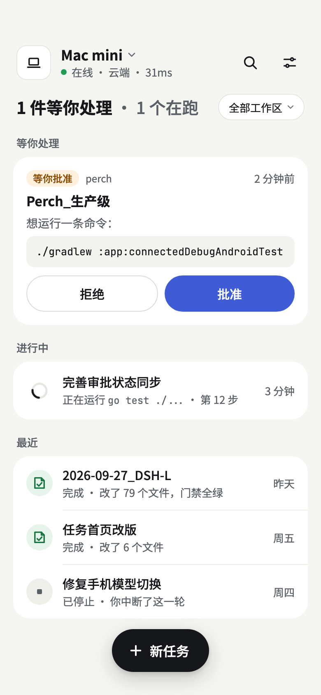</td>
    <td width="25%">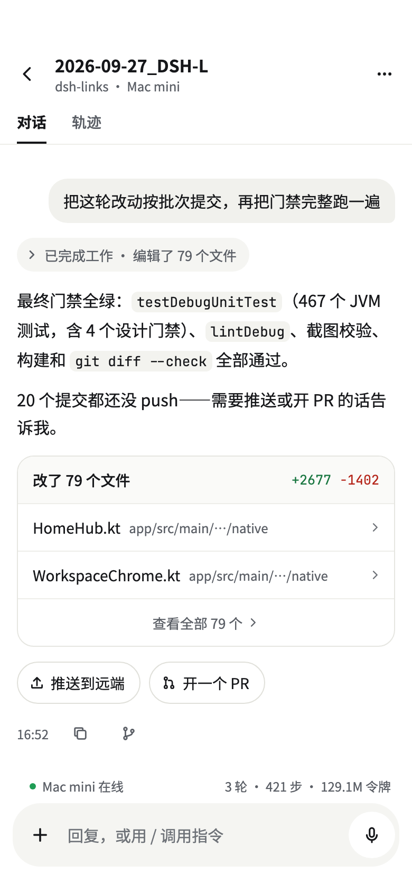</td>
    <td width="25%">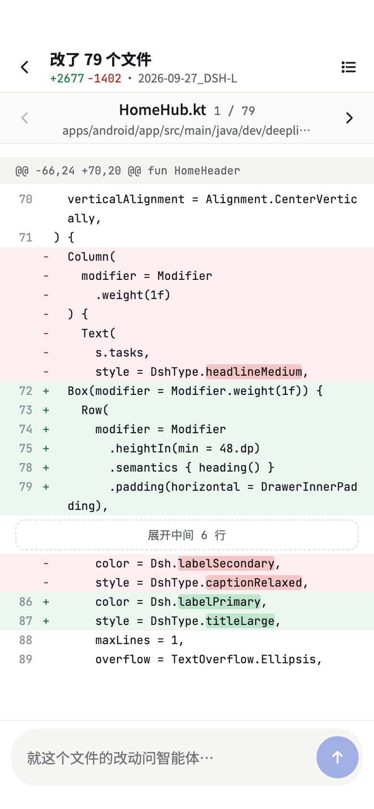</td>
    <td width="25%">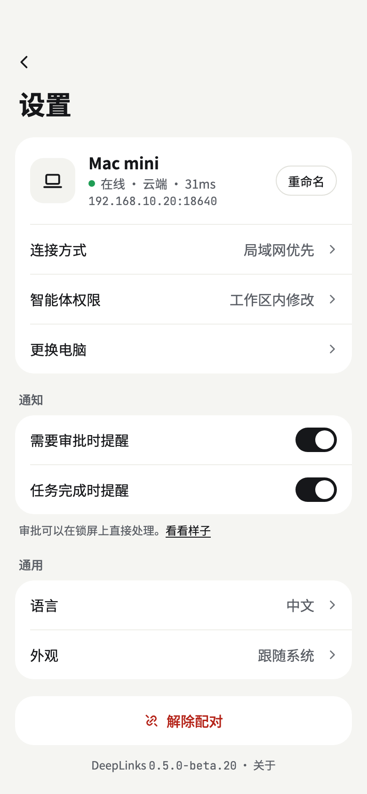</td>
  </tr>
  <tr>
    <td align="center"><sub>任务收件箱 · 等你处理 / 进行中 / 最近</sub></td>
    <td align="center"><sub>会话工作台 · Markdown 与工具轨迹</sub></td>
    <td align="center"><sub>查看改动 · 文件差异与提问</sub></td>
    <td align="center"><sub>设置</sub></td>
  </tr>
</table>

<p align="center"><sub>Android 核心页面预览（覆盖手机 / 平板、浅色 / 深色、多任务收件箱、代码改动审查、双端审批与通知系统）。</sub></p>

<details>
  <summary>查看全部 14 个页面与状态</summary>

  <table>
    <tr>
      <td><br /><sub>01 · 首页</sub></td>
      <td><br /><sub>03 · 对话页</sub></td>
    </tr>
    <tr>
      <td><br /><sub>04 · 看改动</sub></td>
      <td><br /><sub>05 · 设置</sub></td>
      <td>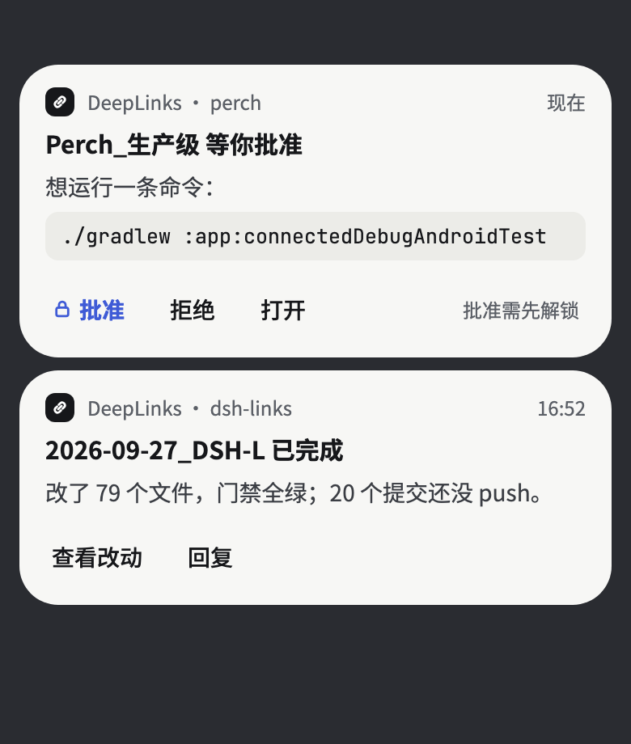<br /><sub>06 · 通知</sub></td>
    </tr>
    <tr>
      <td>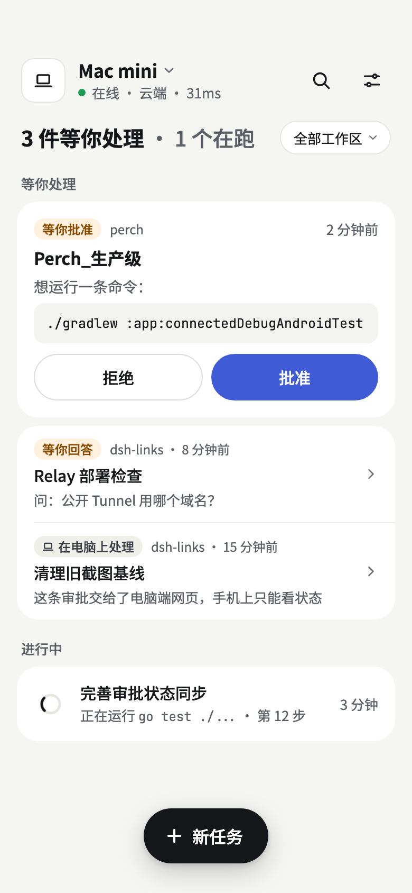<br /><sub>07 · 多件待处理</sub></td>
      <td>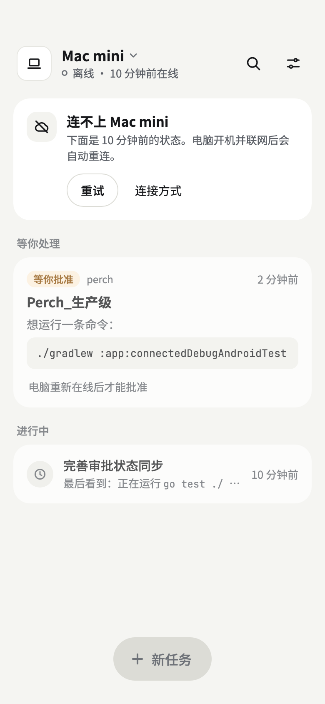<br /><sub>08 · 电脑离线</sub></td>
      <td>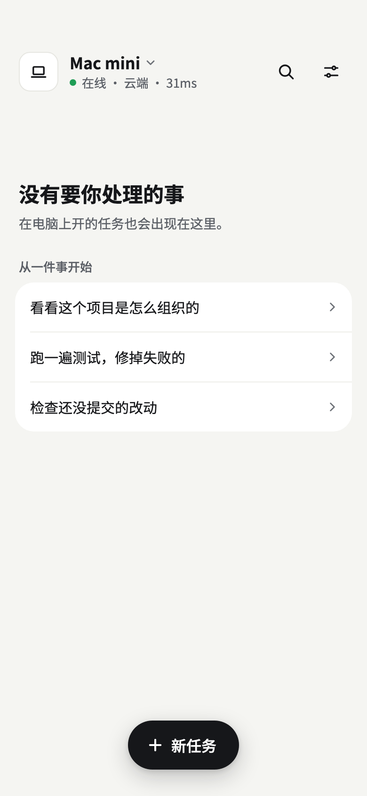<br /><sub>09 · 首页空态</sub></td>
    </tr>
    <tr>
      <td>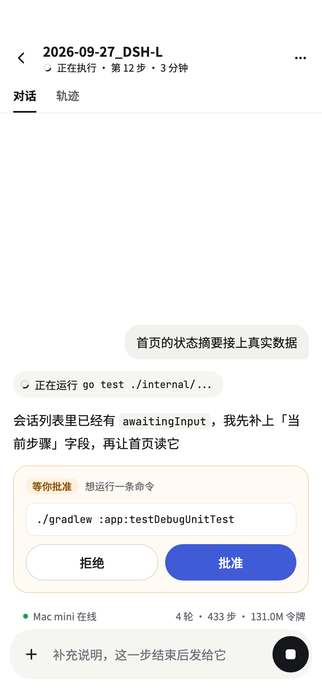<br /><sub>10 · 对话执行中</sub></td>
      <td>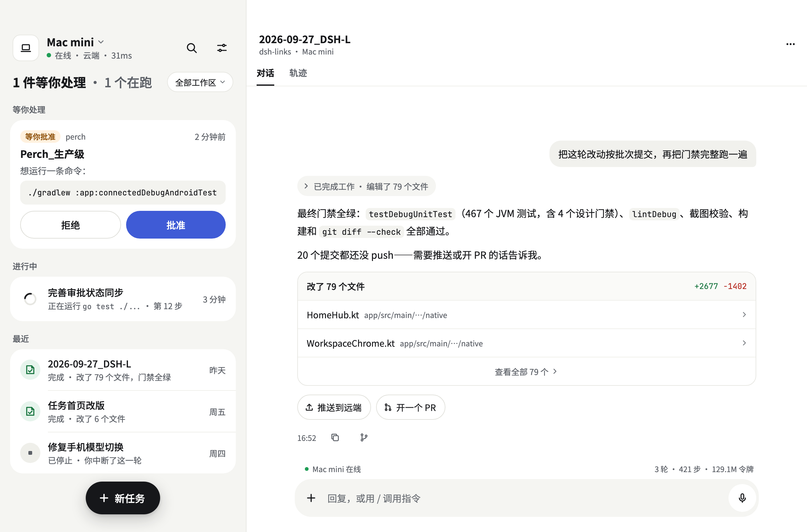<br /><sub>11 · 平板横屏</sub></td>
      <td>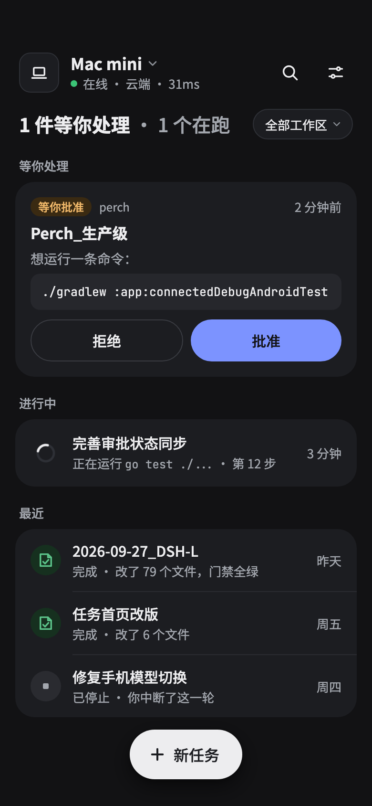<br /><sub>12 · 深色首页</sub></td>
    </tr>
    <tr>
      <td>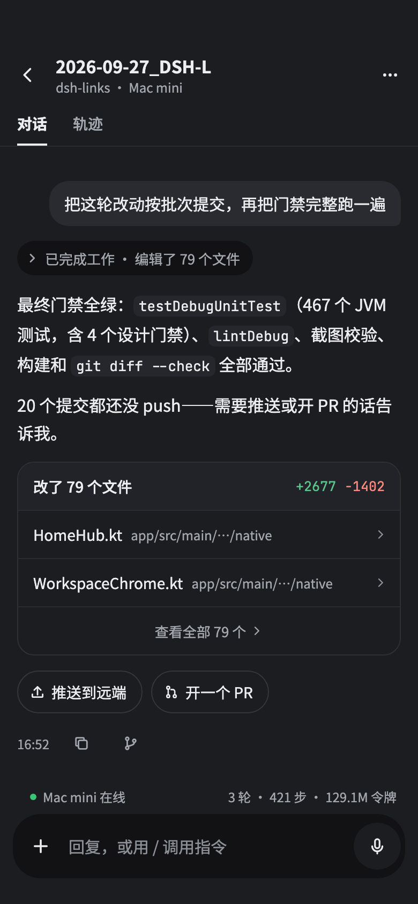<br /><sub>13 · 深色对话</sub></td>
      <td>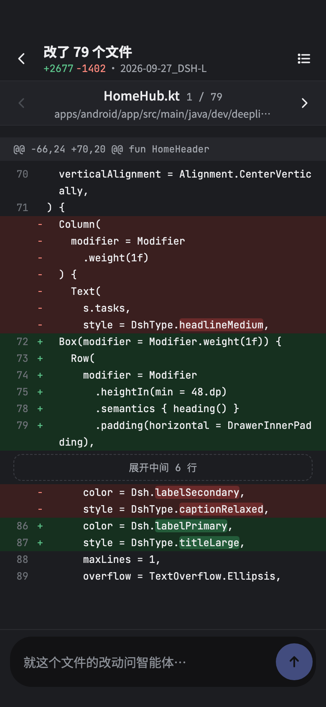<br /><sub>14 · 深色看改动</sub></td>
      <td>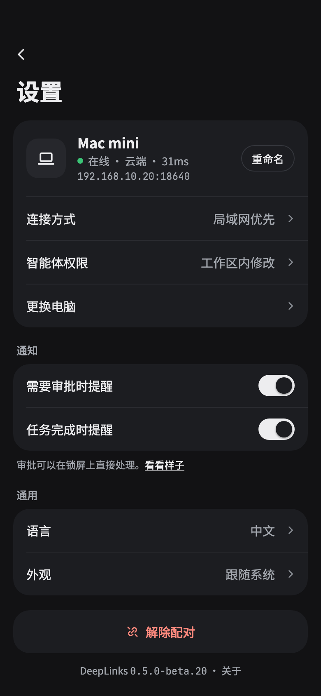<br /><sub>15 · 深色设置</sub></td>
    </tr>
  </table>
</details>

---

> [!IMPORTANT]
> **本项目为独立的社区项目。** DeepLinks 与 DeepSeek 无隶属、授权或背书关系；DeepSeek Harness 的名称与相关标识归各自所有者。问题请在本仓库反馈，不要提交给上游。
>
> **项目处于公开 Beta。** 正式支持范围是**可信局域网**。出门优先用 Tailscale（零服务器、直连）；中继（DLP/1）是免配置备选，仍为实验性功能。插件、App 与同步协议迭代较快，升级前请看 [`CHANGELOG.md`](CHANGELOG.md) 与 [兼容矩阵](docs/COMPATIBILITY.md)；动手改代码前先读 [维护手册](docs/MAINTENANCE.md)。

## 远程连接

电脑和手机在同一个 Tailscale 网络里时，配对二维码会自动带上 Tailscale 地址。手机先试局域网主地址，不通再试这条直连，都失败才走中继。不需要自己填 `100.x` 地址，也不用另开一台服务器。中继是没装 Tailscale 时的免配置备选。细节见 [`REMOTE_ACCESS.md`](REMOTE_ACCESS.md)。

---

## 概览

**DeepLinks** 让运行在电脑、家中主机或远程服务器上的 DeepSeek Harness 拥有一个经过配对的原生手机入口。电脑继续运行 DSH、工具与工作区；手机负责看会话、发消息、收实时事件、处理审批与提问。

它不是远程桌面，也不是把 DSH Web 塞进手机浏览器：一个仓库、三个发布物、一条配对信任链。

| 发布物 | 位置 | 作用 | 分发 |
|---|---|---|---|
| **DSH 插件** `dsh-links` | [`src/`](src/) | 手机 HTTPS 接入代理、配对与设备状态机、电脑端「手机连接」面板 | 本仓 git 源（`github:wlxz-v/dsh-links`，固定版本见 [Releases](https://github.com/wlxz-v/dsh-links/releases)） |
| **Android App** | [`apps/android/`](apps/android/) | 扫码配对、原生会话工作台、实时流、审批与提问 | 签名 APK，见 [Releases](https://github.com/wlxz-v/dsh-links/releases?q=app-v&expanded=true)（`app-v*`） |
| **Relay** | [`relay/`](relay/) | 远程连接的哑管道中继（DLP/1，`cmd/dlp-relay`），只拼接两条 WSS | 源码公开；可用官方中继或自建，无需接入码 |

---

## 设计原则

- **信任方向只有两条。** 手机 → 插件（持配对签发的设备 token，走 HTTPS）；插件 → Host（仅本机回环 RPC）。手机永远不直达 Host。跨设备吊销、全部吊销、工作区批准这类高危操作只存在于回环面板，手机 API 刻意不提供。
- **原生，而不是套壳。** 工作台是 Jetpack Compose：Material 3 负责结构、导航、状态与无障碍，色值与节奏以 DSH Web 为唯一参照（[视觉合同](apps/android/docs/visual-rules.md)）。
- **门禁即验收。** 设计 token、间距刻度、色源、文件与函数体量都有单测门禁，预算只降不升；UI 改动随 PR 提交截图基线。
- **冒烟必须隔离。** 任何联调都用独立 `stateDir`，不碰真实配对——这条规则来自一次真实事故，写在 [`CLAUDE.md`](CLAUDE.md) 的红线里。

## 功能

### 配对与信任

- **扫码或 6 位配对码**：电脑端「手机连接」面板生成二维码与配对码，一次性、可防重放；同名设备走显式替换流程。
- **证书固定**：首次配对即固定电脑端自签 TLS 证书指纹，之后每次连接逐位校验；App 禁用明文 HTTP。
- **凭据只在 Keystore**：设备 token 与证书指纹以不可导出的 Android Keystore 密钥加密保存，禁用云备份；卸载即失效。
- **审批式工作区注册**：手机只能提交已存在目录的真实路径，由电脑端面板批准后才创建。

### 原生会话工作台

- **流式渲染**：SSE 实时推送，新到字符逐段淡入，不整屏闪烁；断线 30 秒内自动重连并按游标续传，缺口时整页重同步。
- **完整的 Markdown**：代码高亮、表格、KaTeX 数学公式、Mermaid 图（均随 APK 离线打包，经锁死的 WebView 渲染）。
- **思考与工具轨迹**：推理过程可折叠，工具调用与结果成组展示；对话 / 轨迹视图切换，支持工具查找、轮次跳转与子代理视图。
- **会话控制**：排队消息可编辑 / 撤回 / 插队；目标可编辑、暂停、继续、清除；「⋯」菜单查看与修改定时任务（需插件声明 `capabilities.control`）。
- **毛玻璃顶栏与输入区**：Android 12+ 背景模糊，省电 / 减少透明度时退回不透明。
- **长回复不卡**：长 Markdown 分段懒加载，流式增量按帧合并。
- **输入**：模型与推理强度选择、图片附件、系统分享到 App、语音输入、命令面板（`/plan`、`/goal` 等）。
- **自适应布局**：手机单栏；平板与折叠屏展开时改用侧边导航栏，改动审查面在宽屏贴右展开。
- **子智能体原生树**：原生支持 Subagent 树状展开、层级溯源与状态徽章展示；单遍建索引与记忆化聚合统计正在运行的子智能体数量，可一键跨会话下钻查看，清晰掌控复杂协作流。
- **极致流畅滑动**：`LazyColumn` 显式启用 `contentType` 槽位复用，剥离不必要的条目动画；引入单段快速测量（`TextStringSimpleElement`）与批量预计算层（`HomeInboxPrep.kt`），消减重组与 GC 抖动，500+ 会话列表满帧滚动。
- **中英双语**：界面文案随系统或手动切换，切换后立即生效（截图基线同时守着中 / 英两轨）。

### 任务收件箱与新任务

- **任务集中处理**：首页按「等你处理 / 进行中 / 最近」分组，显示电脑在线状态、工作区筛选和任务摘要；电脑离线时保留最近状态并提供重连入口。
- **双端协同待办**：待处理事项（工具审批与澄清提问）全量同步推送到手机端，无论电脑当前是否正处于该会话，双端任一端作答即时跨端同步关闭；电脑离线时保留快照，重新连上后无缝补发与校验状态。
- **新任务草稿态**：点「+ 新任务」进入对话页草稿态——「继续上次的任务」、工作区胶囊（行尾常驻「更多」打开选择器）与智能体预设贴底陈列，直接复用对话页输入栏发送；系统分享进来的文本与图片也落在草稿态输入框。旧的底部面板已删除。

### 审批与提问

- **工作内容与真实命令全透出**：根据 callId 实时回填完整工具调用与命令参数，`run_code` 展现代码源码，桌面与插件工具透出执行说明；卡片、会话底部决策栏与系统通知展开区均清晰展现真实命令原文（若遇极少数无参数异常则诚实安全降级提示）。
- **双端协同同推（先答先算）**：审批与提问同时推送到电脑与手机端，任一端作答即时同步收起另一端，锁屏通知栏提供快捷操作按钮；断线重连宽限期内请求不丢失，提交严格幂等。
- **多轮澄清题目前推**：支持连续多题依次选择推进，通知栏直接携带题干与快捷选项，作答后即时推进下一题；支持单选、多选与自由输入，服务端实时校验答案。
- **请求快照与终态同步**：重连后以服务端最新请求状态为准，已在电脑端处理的请求在手机上即时同步为终态并收起。

### 改动与文件

- **内置原生 PDF 预览**：会话产出与工作区内的 PDF 文档原生支持在屏预览（系统自带 `PdfRenderer` 多页流畅渲染），无需跳出 App 或安装庞大第三方阅读器。
- **外部应用委托与分享**：除文本、代码、图片与 PDF 支持就地预览外，其他格式文档（表格、压缩包、多媒体等）通过 Android `FileProvider` 安全委托外部系统应用打开或进行系统级分享。
- **本轮改动与审查面**：每轮结束附改动卡（文件数、增删行），点开进入审查面——文件列表与逐块对比，宽屏贴右展开。
- **词级高亮**：删除行与新增行按顺序配对后，标出行内真正变化的片段；整行重写不标，避免满屏噪音。
- **下载与完整性校验**：文件响应带 SHA-256，App 校验不一致即丢弃；工作区文件浏览支持目录层级导航与沙箱越界防护。
- **本轮产出**：代理写入的文件以卡片列出，支持一键预览、复制路径或调用系统应用。

### 本地优先

- **会话秒开**：打开会话先显示上次的本地快照，网络结果回来后整体接管。快照以独立 Keystore 密钥加密、按主机隔离，未结束的审批在快照里只显示「状态待确认」，不可提交。
- **草稿不丢**：输入框正文按主机落盘，进程被系统回收后回到同一会话仍在；发送途中被杀的消息会停在本地，回来后回填而不是自动重发。

---

## 架构

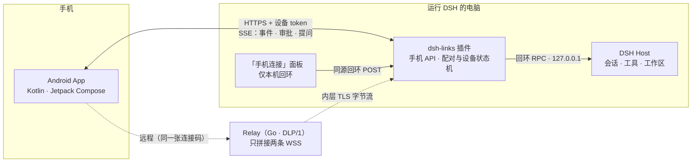

一条请求的生命线、目录契约与两条关键设计线（审批式工作区注册、SSE 续传）见 [`docs/ARCHITECTURE.md`](docs/ARCHITECTURE.md)；手机 API 的字段级契约见 [`docs/MOBILE_SYNC_CONTRACT.md`](docs/MOBILE_SYNC_CONTRACT.md)。

---

## 目录结构

```text
dsh-links/
├── src/                          # DSH 插件
│   ├── index.js                  # 入口：路由注册、配对 / 设备状态机、Runtime 装配
│   ├── mobile-api.js             # 手机 HTTPS API 唯一实现（/dsh-link/mobile/*）
│   ├── panel.js                  # 「手机连接」面板源码（client.js 由 build-client.mjs 生成）
│   ├── workspace-*.js            # 工作区注册、改动转发、文件与目录沙箱
│   └── remote/                   # 远程连接：Agent、运行时、state（DLP/1）
├── relay/                        # DLP/1 中继服务端（Go，dlp-relay），独立部署
├── apps/android/                 # Android App（Android Studio 打开这里）
│   ├── app/src/main/java/dev/deeplinks/
│   │   ├── core/                 # 跨屏契约：主题 / 排版 / 颜色 token、本地化、加密、布局推导
│   │   │   └── remote/           # DLP/1：自动选路、隧道 socket、远程路由
│   │   ├── native/               # 工作台屏幕与 Compose 组件
│   │   └── devices/              # 配对、扫码与设备管理
│   ├── app/src/test/             # JVM 单测与架构门禁（token / 间距 / 色源 / 体量预算）
│   ├── app/src/screenshotTest/   # Compose 截图测试；基准图在 screenshotTestDebug/reference
│   └── docs/                     # 视觉合同与 UI 贡献规则
├── test/                         # 插件 node:test 套件
├── scripts/                      # 真中继端到端、架构冒烟、内测证据收集
├── testdata/dlp1/                # DLP/1 三端共用测试向量（JS / Go / Kotlin）
└── docs/                         # 架构、同步契约、兼容矩阵、RFC、内测计划
```

---

## 快速开始

1. **在运行 DSH 的电脑上安装插件**，并启动 DSH Web：

   ```bash
   dsh plugin --profile web add github:wlxz-v/dsh-links
   dsh web
   ```

   上面装的是 `main`（当前 Beta 源）。要固定版本，在地址后加 [Releases](https://github.com/wlxz-v/dsh-links/releases) 里的插件 tag，例如 `#v0.1.0-beta.18`；插件与 App 的配套关系见 [兼容矩阵](docs/COMPATIBILITY.md)。

2. **配对**：打开 DSH Web 设置 →「手机连接」，用 App「扫描二维码」或「从相册识别」（选择一张含连接二维码的截图）完成配对。

   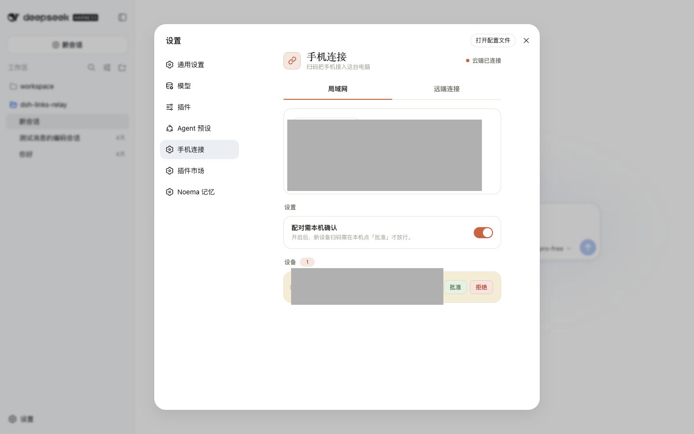

3. **开始使用**：在 App 里选择已配对的电脑，进入会话工作台。

> [!NOTE]
> 配对不需要账号。远程访问（内置远程连接、Tailscale、Cloudflare Tunnel）见 [`REMOTE_ACCESS.md`](REMOTE_ACCESS.md)。**不要**把 `18640` 端口直接做路由器端口转发。

---

## 开发与构建

### 环境要求

- **Node.js** `>= 20`，**pnpm**（插件依赖锁定在 `pnpm-lock.yaml`）
- **JDK 17 与 Android SDK**（`minSdk 26`、`targetSdk 36`；AGP 9.3、Kotlin 2.4）
- **Go** `1.25`（仅中继）
- 一台运行 DeepSeek Harness 的电脑；当前基线见 [兼容矩阵](docs/COMPATIBILITY.md)

### 插件

```bash
pnpm install
npm run prepack        # 生成面板 client.js + 全量测试
npm test               # 仅跑 node:test 套件
```

开发期可直接挂本地目录：`dsh plugin --profile web add /path/to/dsh-links`。改完源码需**重启 host** 才生效。

> [!WARNING]
> 插件 state 默认全局共享（`~/.dsh/dsh-links/state.json`，不分 profile）。任何冒烟或联调都必须通过 `stateDir` 配置隔离，且不得调用吊销类操作——否则会吊销你真实手机的配对。

### Android App

```bash
cd apps/android
./gradlew :app:assembleDebug :app:testDebugUnitTest :app:lintDebug
./gradlew :app:validateDebugScreenshotTest     # 截图基线校验
./gradlew :app:updateDebugScreenshotTest       # 改 UI 后更新基线，逐张人工审图后随 PR 提交
```

debug 变体的包名带 `.debug` 后缀，与签名 release 共存、互不覆盖；真机设备测试一律走 debug 变体（完整命令见 [`apps/android/README.md`](apps/android/README.md)）。

### 中继

```bash
cd relay
gofmt -l . && go vet ./... && go build ./... && go test ./... -race
```

自建部署见 [`relay/README.md`](relay/README.md)。

### 质量门禁

CI 分三路：插件跑面板生成物一致性、`node:test`、打包清单与依赖审计；中继跑 race 测试、vet 与控制帧 fuzz；App 跑 JVM 单测（含 DLP/1 三端共用向量）+ lint、截图校验与 debug / release 构建，模拟器 job 真正执行设备测试（冷启动冒烟 + 公式 / Mermaid 渲染链路 + TokenCrypto 并发首生），release 的 R8 mapping 上传为制品用于崩溃反混淆。App 单测里包含一组**架构门禁**：

| 门禁 | 守住什么 |
|---|---|
| `DesignTokenUsageTest` / `ComponentLanguageTest` | 颜色、圆角、字号只能来自 token，组件语法统一 |
| `DshPaletteProvenanceTest` | 主题色取自 DSH 调色板镜像，偏离必须写明原因 |
| `DshSpacingUsageTest` | 间距走 `DshSpace` 刻度，刻度外存量只降不升 |
| `CodeHygieneTest` | 文件与函数体量预算，只降不升 |
| 截图测试 | 设计系统、对话流、审批 / 提问卡、改动面板的亮 / 暗、中 / 英、大字号基线 |

### 发布

插件不发布到 npm registry：直接以本仓 git 源安装/更新。App 只发本机签名的 APK，附在 `app-v*` Release 上。完整核对清单见 [`RELEASING.md`](RELEASING.md)。

---

## 安全与隐私

- 配对 token、TLS 证书指纹与会话本地快照均以 Android Keystore 密钥加密保存，禁用云备份；敏感界面启用 `FLAG_SECURE`。
- 对话中的网络图片默认不自动加载（防止提示注入借图片外传内容、暴露 IP），点按单张才加载且仅限 HTTPS；设置「隐私」分组可改为自动加载。
- App 只走 TLS；渲染不可信内容的 WebView 禁止文件与 content URL 访问、禁止联网并加 CSP（只放行随包打包的 KaTeX / Mermaid）；release 构建剥离并脱敏日志。
- 中继（DLP/1）只拼接手机与电脑各自向外建立的 WebSocket，转发的是内层 TLS 加密字节流；它不保存账号、设备档案或任何业务内容，只在内存里保留在线路由、活跃流与聚合流量计数。
- 电脑只在验证过手机的会合密钥之后才连本机端口；业务授权仍是设备 Token，吊销设备立即断开它的远程连接。
- 手机连接码在有效期内可以添加新设备（远程首配仍需电脑上批准），请勿截图外传。

完整说明见 [`PRIVACY.md`](PRIVACY.md) 与 [`SECURITY.md`](SECURITY.md)。

### 官方 APK 签名证书

```text
CN=DSH Links, OU=lunaship, O=lunaship, C=CN
SHA-256: 38f71adf8b67d81042c99a3ec0dfdafb4303dd31e3fc491068ccd534cb482a47
```

签名证书仍使用旧名称；校验已发布 APK 时请以 SHA-256 指纹为准。

安装前可用 `apksigner verify --print-certs <apk>` 核对。

---

## License

DeepLinks 以 [MIT](LICENSE) 许可发布。

「DeepLinks」名称、logo 与应用图标**不在** MIT 授权范围内；第三方 fork 请更换名称、图标与 `applicationId` 后再分发。随包的第三方库与资源保留各自许可，见 [`THIRD_PARTY_NOTICES.md`](THIRD_PARTY_NOTICES.md) 与 [`apps/android/THIRD_PARTY_NOTICES.md`](apps/android/THIRD_PARTY_NOTICES.md)。

---

## 致谢

- **[DeepSeek Harness](https://github.com/deepseek-ai)**：本项目服务的对象；插件运行在它的 cordis 插件体系之上。
- **[Lody iOS](https://github.com/Innei/lody-ios)**：本地快照秒开、词级 diff、工作区文件树与离线截图验收的思路，以及这份自述的结构，都受它启发。
- **[KaTeX](https://github.com/KaTeX/KaTeX)** 与 **[Mermaid](https://github.com/mermaid-js/mermaid)**：离线打包的数学公式与图表渲染。
- **[OkHttp](https://square.github.io/okhttp/)**、**[Coil](https://github.com/coil-kt/coil)**、**[ZXing Android Embedded](https://github.com/journeyapps/zxing-android-embedded)**：网络、图片与扫码。
- **[Plus Jakarta Sans](https://github.com/tokotype/PlusJakartaSans)**：界面字体。
- **[node-qrcode](https://github.com/soldair/node-qrcode)** 与 **[selfsigned](https://github.com/jfromaniello/selfsigned)**：配对二维码与自签 TLS 证书。
